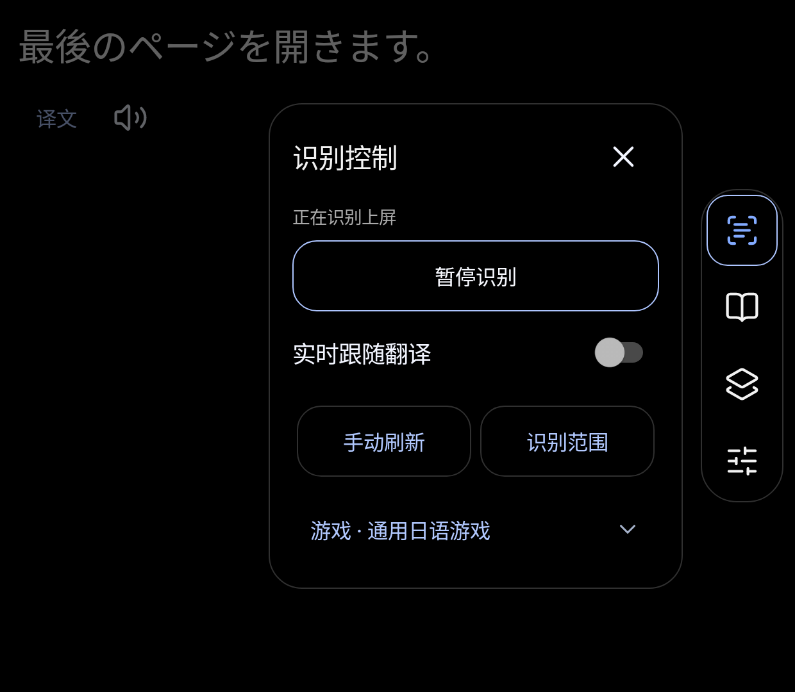

# ScreenStudy · 双屏日语伴读 0.35

**By 快转风景Nevermore**

主屏玩日文游戏，副屏看台词、点词查义和做练习。适用于提供独立副屏的安卓设备；当前以 AYN Thor 的使用环境为基础维护。

**[下载最新安装包与完整教程包](https://github.com/hzz19980728-cell/ScreenStudy/releases/latest)** · [安装教程](docs/installation.md) · [使用教程](docs/usage.md) · [常见问题](docs/faq.md) · [反馈问题](https://github.com/hzz19980728-cell/ScreenStudy/issues)

## 第一次使用，从这里开始

1. 下载 `ScreenStudy-0.35.apk` 安装到安卓掌机。桌面图标叫“双屏日语伴读”。
2. 进入“设置 → 翻译服务”，填写自己的服务地址、模型和 API 密钥，保存并测试连接。默认接口示例：`https://api.deepseek.com`、`deepseek-flash`。
3. 主屏打开游戏，副屏打开伴读，进入识屏控制，点击“开始识别”，允许系统屏幕采集。
4. 到“设置 → 识别设置 → 识别范围”，框选主屏台词区域并保存，再回到伴读点词或展开中文。

识字模型已在 APK 内，不需要 Shizuku、Root、无障碍或悬浮窗授权。**联网翻译需要自己的 API 密钥和服务额度**；想听日语朗读，还需要系统离线日语语音包。详见 [所需软件与官方入口](docs/requirements.md)。

## 能做什么

- 本地识别主屏日文，在副屏显示分词后的台词。
- 点词查中文释义，展开整句中文，按需开启实时跟随翻译。
- 单词本、收藏、复习和六种练习题型。
- 各游戏配置、识别范围、字号、识别频率、纯黑/深蓝主题。
- 学习资料导出、恢复和未完成练习的继续。

## 安装包怎么选

| 文件 | 用途 |
| --- | --- |
| `ScreenStudy-0.35.apk` | 直接安装到安卓设备 |
| `ScreenStudy-0.35-Share.zip` | 安装包 + 图文教程 + 文字教程 + 官方软件入口，适合网盘转发 |
| `ScreenStudy-0.35.sha256` | 核对 APK 完整性 |
| `ScreenStudy-0.35.release.json` | 版本、署名、包名和校验元数据 |
| GitHub 自动生成的 Source code | 仓库文档压缩包，不是安卓安装包 |

请从 [Releases](https://github.com/hzz19980728-cell/ScreenStudy/releases/latest) 下载 APK 或完整分享 ZIP；普通用户不需要克隆仓库或安装开发工具。网盘文件夹与 GitHub Release 中的软件是同一发行包。

## 设备适配到什么程度

最低 Android 8.0；APK 内含 ARM 和 x86 的 32/64 位库。软件使用可滚动的自适应布局。0.35 补上只变高度时的刷新、安全边缘和短窗口导航滚动，并验证六组不同副屏尺寸/密度/字体组合。

**其他品牌没有对应真机，不能保证全部可用。** 当前读取的是 Android 主显示屏，伴读尝试打开非主屏；厂商必须支持独立副屏应用和主屏采集。折叠屏分区、镜像显示和厂商专用副屏不一定满足这个条件。见 [详细适配说明与测试范围](docs/compatibility.md)。

## 教程目录

- [安装、授权与翻译服务配置](docs/installation.md)
- [每天使用、点词、单词本、练习和备份](docs/usage.md)
- [需要装的软件及官方入口](docs/requirements.md)
- [双屏兼容与下屏自适应](docs/compatibility.md)
- [常见问题](docs/faq.md)
- [数据与隐私](docs/privacy.md)
- [更新记录](docs/changelog.md)

## 老用户更新

本系列包名 `local.screenstudy.mac`、固定签名保留，0.35 / versionCode 69 可覆盖更新。先导出学习备份，再直接安装新 APK。遇到签名冲突不要先卸载；早期 `local.screenstudy` 包名或其他签名版本需要单独处理迁移。

## 公开仓库说明

这是公开的安装包与中文文档分发仓库，当前未提供完整可独立编译的原始源码。应用与文档保留作者署名；第三方组件遵循各自许可。请勿在 Issues 中公开自己的 API 密钥、个人数据库或私人学习备份。

API 配置例子核对于 2026-11-01：[DeepSeek 官方文档](https://api-docs.deepseek.com/zh-cn/)。系统语音设置见 [Google 官方说明](https://support.google.com/accessibility/android/answer/6006983?hl=zh-Hans)。
