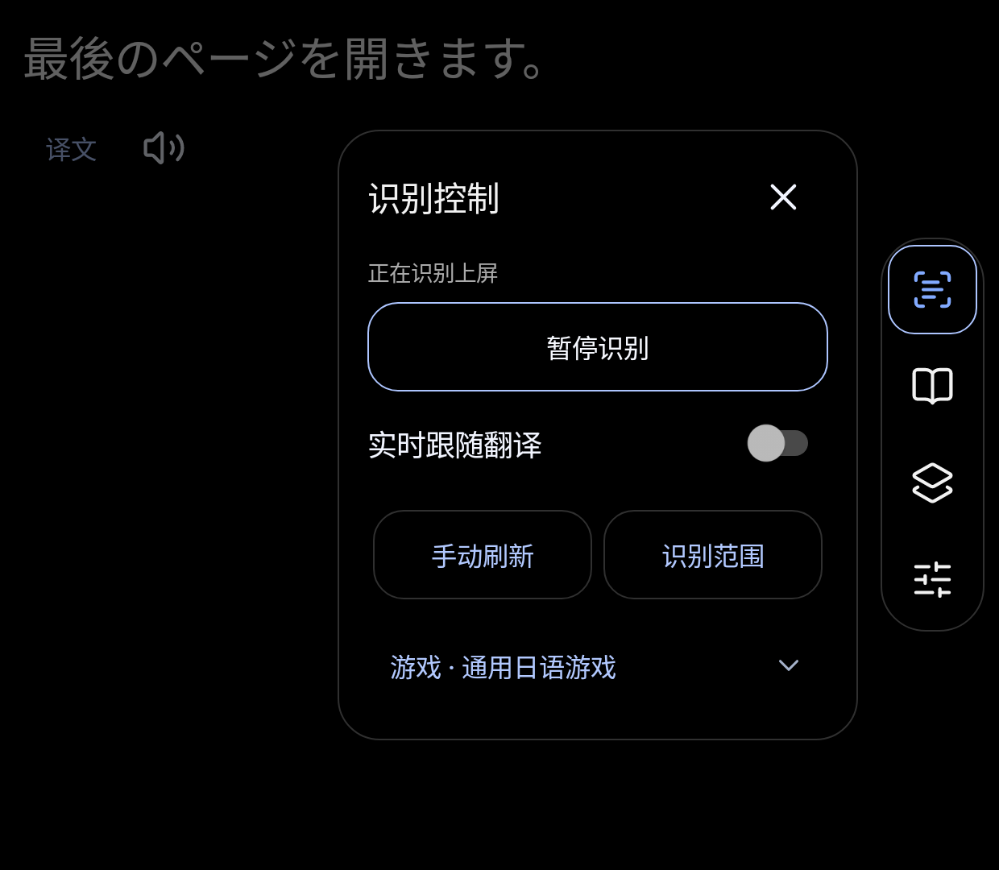
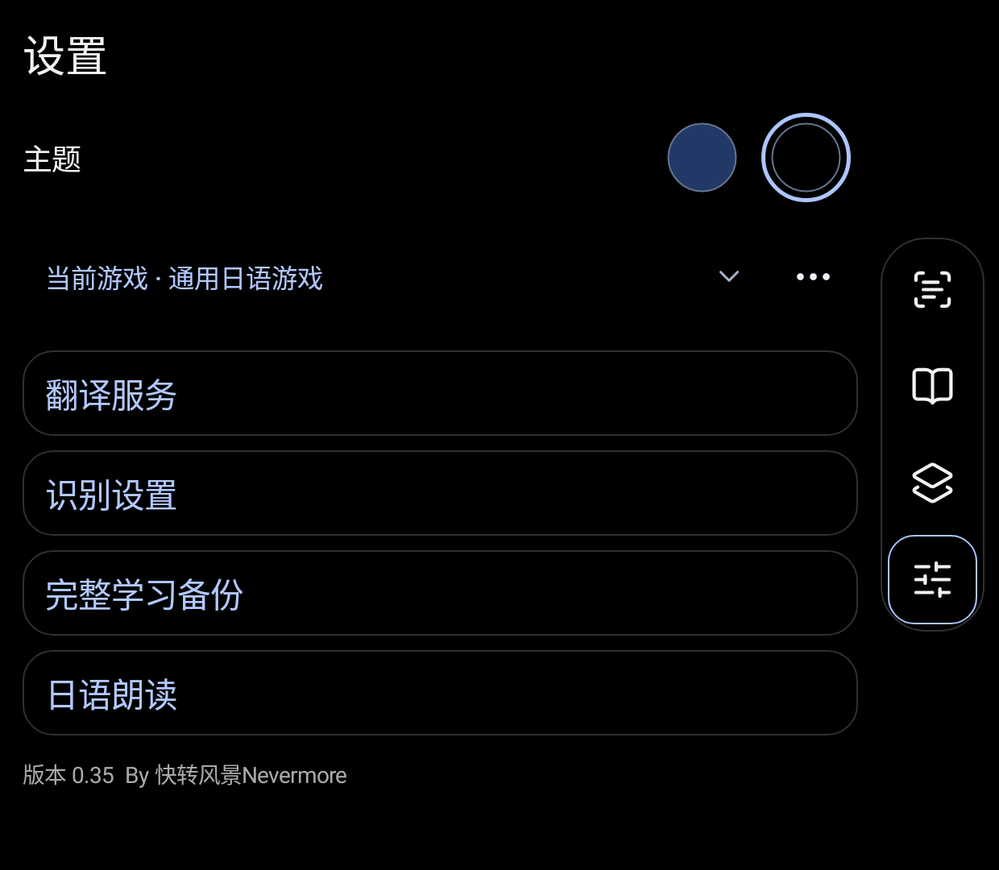
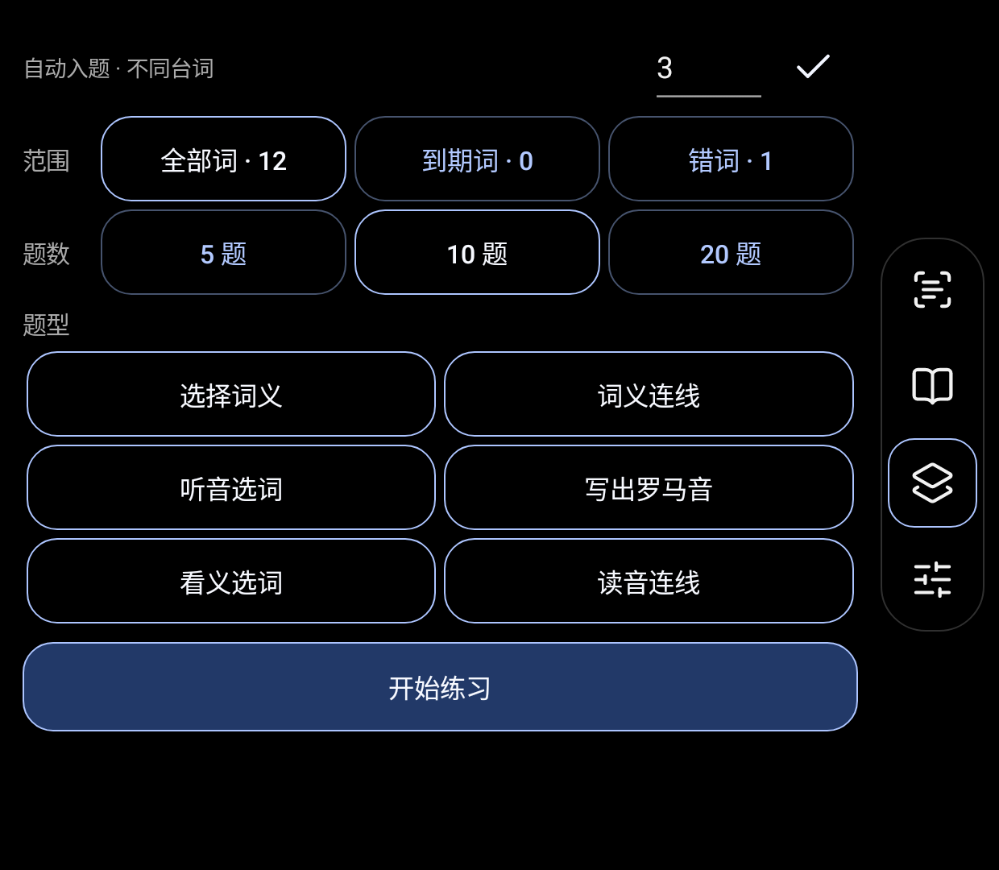

# 使用教程

适用版本：ScreenStudy / 双屏日语伴读 0.35 · By 快转风景Nevermore

## 每次打开游戏时

1. 主屏打开游戏，副屏打开“双屏日语伴读”。
2. 进入识屏页，打开识别控制，点击“开始识别”并完成系统授权；已暂停的会话点击“继续识别”。
3. 选择对应游戏配置，检查识别范围是否仍对准对话框。换游戏或画面布局后重新框选。
4. 主屏出现台词后，在副屏阅读日文、查看中文、点词查义。
5. 暂时不需要更新时点“暂停识别”；彻底结束读取，可使用系统识别通知中的“停止”，或系统屏幕共享的停止入口。

暂停保留当前读取会话，便于继续；关闭整个采集会话后，下次可能重新请求授权。

## 右侧四个图标

| 从上到下 | 用途 |
| --- | --- |
| 识屏 | 回到伴读；在伴读页再点击会打开开始识别 / 暂停识别 / 继续识别控制 |
| 单词本 | 查找、收藏、管理查过的单词 |
| 练习 | 选择范围、题数和题型，开始或继续练习 |
| 设置 | 翻译服务、识别、日语朗读、学习备份、主题 |

蓝色边框表示当前页面。识屏图标本身变蓝，表示正在识别且没有暂停。较矮的窗口中，右侧按钮区域可以上下滑动；正文区域也可以滚动。

## 整句中文、点词和固定台词

- 整句中文：点击台词下方的译文区域展开中文；第一次使用时先配置翻译服务。
- 点词：点击日文词语查看释义、读音；词卡上的关闭按钮可关闭查词。
- 词语朗读：点扬声器图标。需要可用的离线日语语音。
- 默认模式：打开译文或查词时会暂时固定原句，方便慢慢看。收起/关闭后接回最新台词。
- 实时跟随：在识别控制或“设置 → 识别设置”开启 **实时跟随翻译**。新台词会持续跟随，触摸和阅读弹窗期间仍保留短时保护。这个开关默认关闭。
- 识别不对时：先检查范围，必要时使用识别控制中的刷新功能。细小假名、低对比度或装饰字体都可能影响 OCR。

## 切换游戏与识别设置

不同游戏可以使用各自的配置、识别范围和最近台词。切换配置后确认正在使用正确游戏；如果系统提示重新框选，按新画面保存范围。

“设置 → 识别设置”可调整台词字号、识别频率、范围以及文字清理。刚开始先保留默认值，优先把识别范围框准。较大字号和较小副屏会需要更多滚动。

## 单词本和练习

点词会形成查词记录，可在单词本中搜索、收藏、编辑释义和管理复习。自动入题阈值按查过的不同台词计算，并非每点一次同一个词都马上增加一道练习。

进入“练习”后直接选择：

- 范围：全部词 / 到期词 / 错词。
- 题数：5 / 10 / 20。
- 题型：选择词义、词义连线、听音选词、写出罗马音、看义选词、读音连线。

“开始练习”按选择的数量新开一轮；有未完成进度时，用“继续上次练习”。连线配对完成后直接点“下一题”。罗马音使用应用内键盘。没有可用日语声音时，可在听力题旁点击“现在不做听力题”，替换本轮未答的听力题。

如果可用单词不足、释义为空或有效干扰项不够，可能暂时无法生成所选练习。先积累更多有释义的单词，再开始。

## 备份与换机

“设置 → 完整学习备份”中导出完整学习资料，保存到自己能找到的位置，再自行上传网盘。恢复前先读预览；恢复会替换当前学习资料，建议先备份当前存档。

备份可保留单词与复习记录、游戏配置、最近台词和练习进度；翻译服务密钥不会跟随学习备份共享。换机后需要重新填写自己的翻译服务配置。不要把含个人学习记录的备份当成软件安装包发给所有人。

## 界面参考

以下图片来自专用模拟器和示例词条，用来认识按钮，不代表每台掌机有相同分辨率，也不包含作者的个人学习数据。

